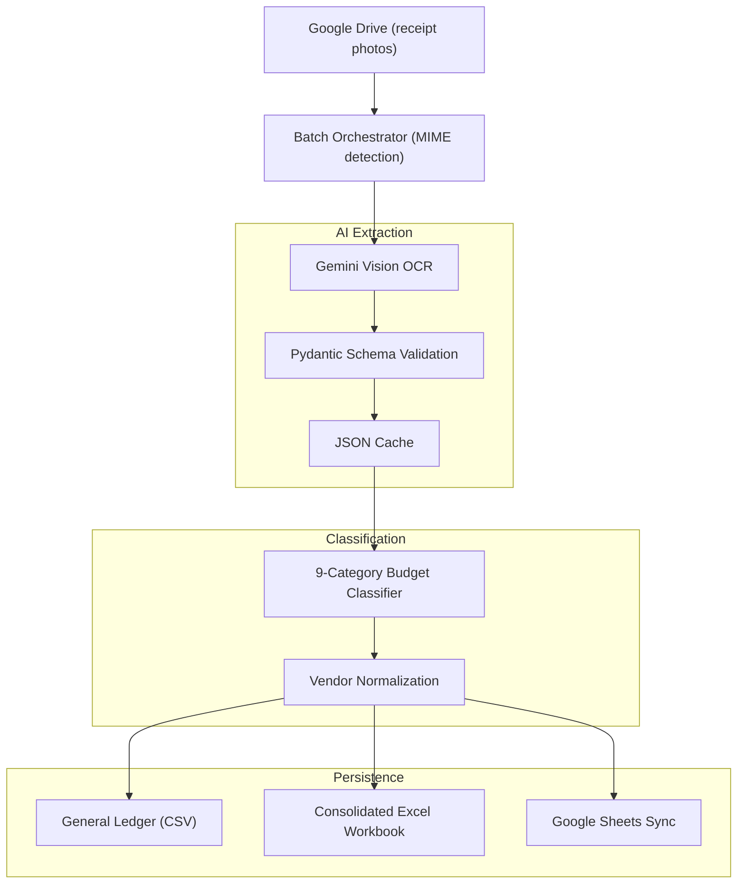

# Bokatas — OCR Accounting Pipeline

[](https://python.org)
[](LICENSE)

An automated accounting pipeline built for [Asociación Bokatas](https://bokatas.org), an NGO that organizes weekly food distribution rounds for people experiencing homelessness in Madrid, Valencia, and Zaragoza.

**The problem:** Volunteers buy groceries at Mercadona, Carrefour, Dia, local bakeries — then someone has to manually type every receipt into a spreadsheet, classify each item into the right budget category, and produce audit-ready reports for grant justification. That's ~200 hours/year of tedious admin work.

**The solution:** This pipeline takes photos of receipts (including crumpled thermal paper and iPhone HEIC files), runs them through Gemini Vision for OCR, validates the output with strict Pydantic schemas, and classifies every line item into one of 9 official budget categories. Output is an audit-ready Excel workbook with per-city breakdowns.

## Architecture



## The 9 budget categories

Every purchased item gets classified into one of these:

1. **Panadería** — bread, rolls, baguettes
2. **Embutidos** — cold cuts, ham, chorizo
3. **Quesos** — cheese
4. **Bebidas** — broth, gazpacho, water, juice
5. **Tortillas** — ready-made potato omelettes
6. **Frutas y Verduras** — fruit and vegetables
7. **Desechables y Enseres** — napkins, gloves, foil, bags
8. **Logística y Transporte** — van fuel, parking, transport passes
9. **Otros** — first-aid supplies, non-recurring items

## Schema validation

Every extraction is validated against a strict Pydantic model, so malformed LLM output gets caught immediately:

```python
class ItemFactura(BaseModel):
    concepto: str
    categoria: CategoriaBokatas  # enforced enum
    cantidad: float
    precio_unitario: float
    total: float

class DatosFacturaBokatas(BaseModel):
    cif_nif: Optional[str]
    proveedor_normalizado: str
    fecha: str
    total_factura: float
    items: List[ItemFactura]
    base_imponible: float
    cuota_iva: float
```

## Running locally

You can test the pipeline without Google Cloud credentials using the included simulation:

```bash
git clone https://github.com/MiguelMartinVieira/bokatas-ocr-accounting-pipeline.git
cd bokatas-ocr-accounting-pipeline

uv venv && uv pip install -r requirements.txt
uv run python demo_simulation.py
```

For live OCR on a real receipt:
```bash
export GEMINI_API_KEY="your-key"
uv run python prueba_02_gemini_ocr.py path/to/receipt.jpg
```

## Output

The pipeline generates `Consolidado_Gastos_Nacional_Bokatas.xlsx` with:
- **Detalle_Gastos** — row-by-row itemized purchases across all cities
- **Resumen_Nacional_Categorias** — cross-tab of spending per category per city

## License

MIT — Built for Asociación Bokatas by [Miguel Martín Vieira](https://linkedin.com/in/miguel-mart%C3%ADn-vieira-77b35b28b).
