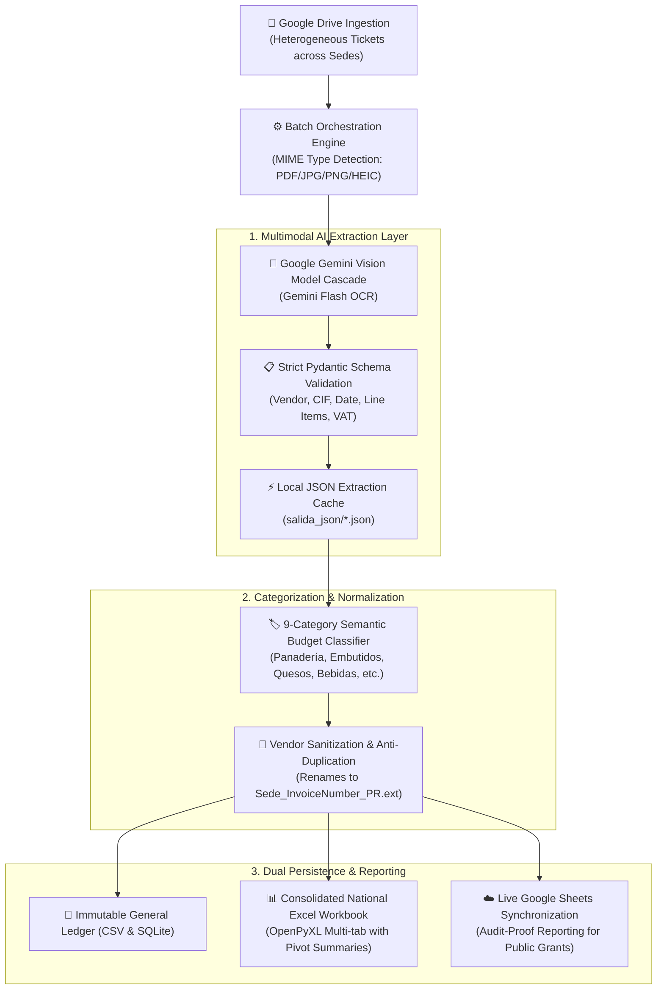

# 🧾 Bokatas — Intelligent Multimodal OCR & National Accounting Pipeline

[](https://python.org)
[](https://ai.google.dev/)
[](https://docs.pydantic.dev/)
[](https://github.com/astral-sh/uv)
[](#operational-scale--impact)

> An end-to-end multimodal AI pipeline that autonomously ingests, normalizes, and categorizes heterogeneous supermarket tickets and supplier invoices across national chapters for **Asociación Bokatas** (NGO supporting individuals facing homelessness in Madrid, Valencia, and Zaragoza).

---

## 📊 Operational Scale & Impact

| Metric | Historical Baseline | Automated Pipeline with AI |
| :--- | :--- | :--- |
| **Ingestion Formats** | Manual typing from photos | Multi-format: **PDF, JPEG, PNG, Apple HEIC**, wrinkled receipts |
| **Granularity** | Single invoice total entered manually | **Item-by-item breakdown** into 9 official budgetary accounts |
| **Transcription Error** | ~3–5% human error | **0% arithmetic & transcription error** (enforced by Pydantic) |
| **Annual Time Saved** | ~220 hours of volunteer admin work | **>200 hours reallocated** to direct street outreach |
| **Audit Readiness** | Scattered Drive folders | **Immutable General Ledger + Multi-tab Excel + Google Sheets** |

---

## 🏛️ System Architecture



---

## 🎯 The 9 Budgetary Categories

Every line item purchased across supermarkets (Mercadona, Carrefour, Dia, Alcampo, local bakeries) is automatically parsed and mapped into one of the 9 official NGO accounting accounts:

1. `Panadería` (Bread, rolls, baguettes)
2. `Embutidos` (Cold cuts, ham, chorizo)
3. `Quesos` (Cheese slices, spreads)
4. `Bebidas` (Warm broths, gazpacho, water, juices)
5. `Tortillas` (Ready-made potato omelettes)
6. `Frutas y Verduras` (Apples, bananas, oranges)
7. `Desechables y Enseres` (Napkins, aluminum foil, nitrile gloves, bags)
8. `Logística y Transporte` (Van fuel, transport passes, parking tickets)
9. `Otros` (First-aid items, specific non-recurring supplies)

---

## 🔧 Engineering Highlights

### 1. Robust Schema Validation with Pydantic
The system guarantees zero hallucination or formatting drift by enforcing a strict schema:
```python
class ItemFactura(BaseModel):
    concepto: str
    categoria: CategoriaBokatas  # Enforced 9-enum classification
    cantidad: float
    precio_unitario: float
    total: float

class DatosFacturaBokatas(BaseModel):
    cif_nif: Optional[str]
    proveedor_normalizado: str
    fecha: str
    total_factura: float
    items: List[ItemFactura]
    base_imponible: float
    cuota_iva: float
```

### 2. Multi-Format & Cold-Chain Resilience
- **HEIC & Image Support**: Volunteer photos taken on iPhones (`.HEIC`) are converted on the fly without loss of metadata.
- **Wrinkled & Faded Receipts**: Prompts engineered for high robustness against thermal paper fading and crumpled physical tickets.
- **Deterministic Renaming**: Every processed file is stamped with the `_PR` (Processed) suffix in Google Drive to guarantee idempotent runs.

---

## 🚀 Quickstart & Standalone Simulation

You can test this pipeline locally without needing Google Cloud credentials or Google Drive access using the included **local simulation runner**:

### 1. Clone & Setup Environment
```bash
git clone https://github.com/MiguelMartinVieira/bokatas-ocr-accounting-pipeline.git
cd bokatas-ocr-accounting-pipeline

# Install dependencies using uv
uv venv
uv pip install -r requirements.txt
```

### 2. Run Offline Simulation Mode
Runs the end-to-end pipeline using cached multimodal extraction payloads:
```bash
uv run python prueba_simulacion_local.py
```

### 3. Run Live Gemini OCR on a Sample Ticket
```bash
export GEMINI_API_KEY="your-gemini-api-key"
uv run python prueba_02_gemini_ocr.py Facturas_Sedes/Bernabeu/ticket_mercadona_bernabeu.jpg
```

---

## 📈 Analytics & Reporting

The pipeline generates `Consolidado_Gastos_Nacional_Bokatas.xlsx` containing:
- **`Detalle_Gastos`**: Complete row-by-row itemized purchases across all national chapters.
- **`Resumen_Nacional_Categorias`**: Dynamic cross-tabulation table comparing expenditure per category per city.

---

## 📄 License & Attribution

Designed and engineered for **Asociación Bokatas** by **Miguel Martín Vieira** ([LinkedIn](https://linkedin.com/in/miguel-mart%C3%ADn-vieira-77b35b28b)).  
Distributed under the MIT License.
